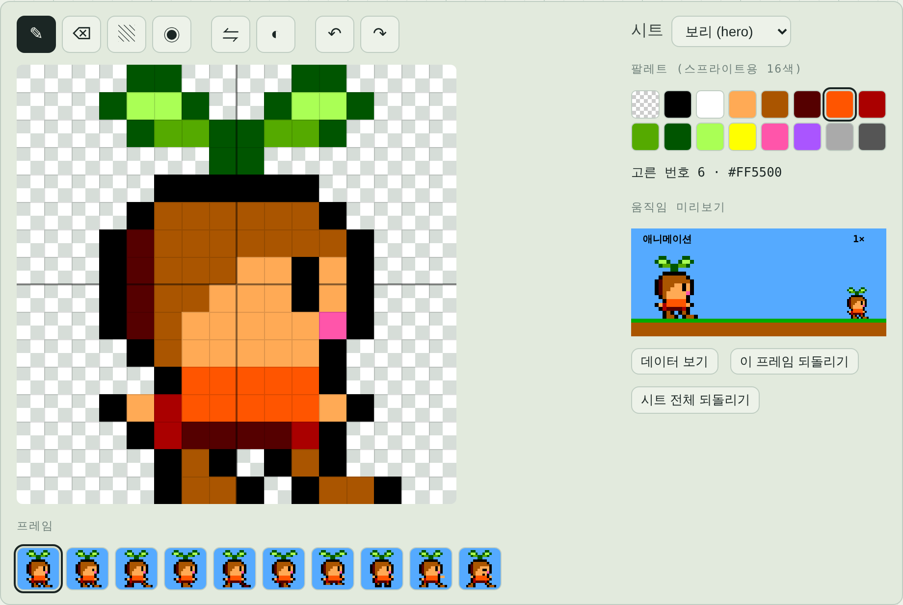
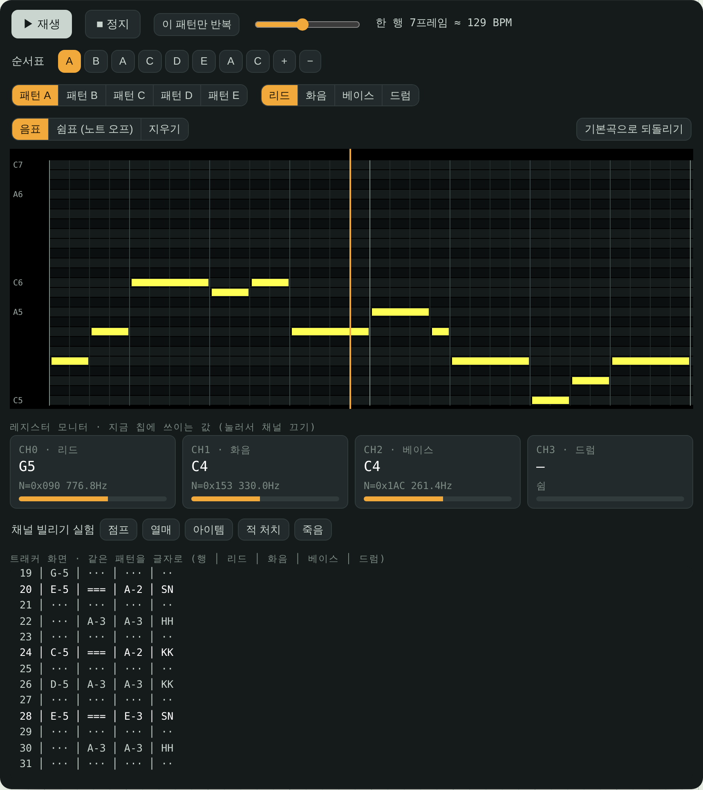
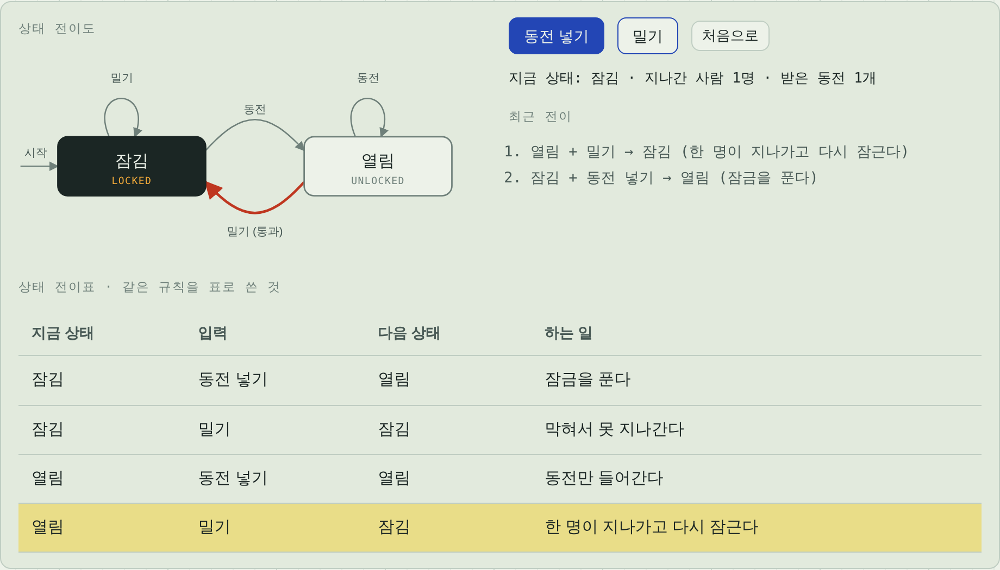
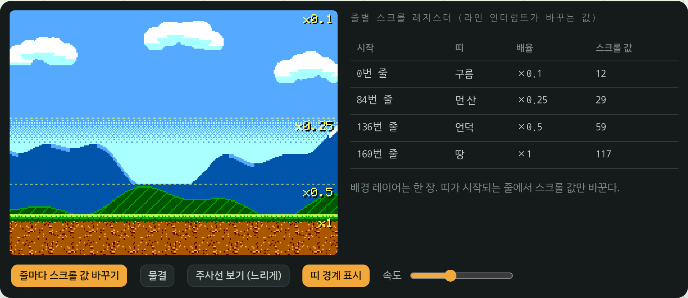

<p align="center">
  
</p>

<h1 align="center">보리 섬 개발 노트</h1>

<p align="center">
  원더보이 스타일 8비트 횡스크롤 액션을 빈 캔버스부터, 돌아가는 부품을 하나씩 만들며 완성하는 인터랙티브 노트.<br>
  HTML, CSS, 자바스크립트만으로 만들었다. 라이브러리도 프레임워크도 없고, 빌드 스크립트 하나뿐이다.
</p>

<p align="center">
  <a href="https://sanghyunpark.pages.dev/apps/bori-island/?lang=ko"><b>노트 열기</b></a>
  &nbsp;·&nbsp;
  <a href="https://sanghyunpark.pages.dev/apps/bori-island/?lang=en">View in English</a>
  &nbsp;·&nbsp;
  <a href="README.md">README (English)</a>
</p>

---

장마다 게임의 부품 하나를 설명하고, 그 자리에서 직접 바꿔 볼 수 있다. 부품들은 실제로 이어져 있다. 픽셀 에디터에서 보리의 옷을 다시 칠하거나, 물리 실험실에서 중력을 올리거나, 레벨 에디터에서 구덩이를 옮기면 마지막 장의 게임이 바뀐 대로 돌아간다.

게임의 규칙은 원더보이(1986)에서 빌려 왔다. 시간이 지나면 줄어드는 체력 게이지, 체력을 채우는 열매, 알(여기서는 꽃봉오리)에서 나오는 무기, 발에 걸리는 돌, 뒤로 돌아가지 않는 스크롤이다. 캐릭터, 그림, 음악, 레벨, 코드는 모두 새로 만들었다. 숫자는 세가 마스터 시스템에서 가져왔다. 256 × 192 화면, 64색 중 16색짜리 팔레트, 한 줄에 스프라이트 8개, 사각파 셋과 노이즈 하나의 음원 칩이다.

## 장 구성

| | 장 | 직접 해 볼 수 있는 것 |
|---|---|---|
| 0 | 시작하며 | 스스로 플레이하는 완성 게임, 하드웨어 사양, 부품이 이어지는 방식 |
| 1 | 게임 루프 | 가변 Δt와 고정 Δt 나란히 비교, 누산기 타임라인, 보간 |
| 2 | 스프라이트와 애니메이션 | 팔레트 번호로 된 픽셀, 애니메이션 표, 팔레트 스왑, 한 줄 8개 제한과 깜빡임 |
| 3 | 타일맵·패럴랙스·카메라 | 타일 검사기, 3D로 펼친 패럴랙스 레이어, 데드존 카메라 |
| 4 | 리소스 저작 도구 | 픽셀 에디터, 오토타일, 그 자리에서 테스트하는 레벨 에디터, 글자 지도·RLE·JSON 형식 |
| 5 | 효과음과 배경음악 | 실제 레지스터 값을 보여 주는 PSG 건반, 효과음 디자이너, 레지스터 모니터가 달린 트래커 |
| 6 | 게임 물리 | 점프 궤적 실험실, 한 단계씩 보는 타일 충돌, 코요테 타임과 점프 버퍼, 터널링 |
| 7 | 입력·상태 기계·연출 | 입력의 눌림과 뗌, 상태 기계란 무엇인가(개찰구, 플래그 대 상태), 보리의 실시간 상태 기계, 연출 스위치, 디버그 화면, 비트맵 폰트 |
| 8 | 하드웨어: 그때와 지금 | VRAM 타일 예산, 래스터 스크롤, 정수 배율, 악보 대 녹음, 믹싱과 덕킹, 처리 지연과 프레임 예산 |
| 9 | 완성: 플레이 | 도구에서 바꾼 것이 모두 들어간 게임 |

페이지 전체가 한국어와 영어로 되어 있다. 브라우저 언어에 맞춰 열리고, 주소 끝에 `?lang=ko`나 `?lang=en`을 붙이거나 옆 목차 아래의 언어 버튼을 눌러 바꿀 수 있다.

## 스크린샷

<table>
  <tr>
    <td width="50%"><br><sub><b>4장.</b> 픽셀 에디터는 프레임마다 팔레트 번호 256개를 저장하고, 모든 게임 화면이 바뀐 그림을 쓴다.</sub></td>
    <td width="50%"><br><sub><b>5장.</b> 흉내 낸 PSG 칩을 움직이는 트래커. 프레임마다 쓰는 레지스터 값이 보인다.</sub></td>
  </tr>
  <tr>
    <td width="50%"><br><sub><b>7장.</b> 상태 기계를 개찰구로 먼저 익히고 보리의 상태 여섯 가지로 넘어간다.</sub></td>
    <td width="50%"><br><sub><b>8장.</b> 래스터 스크롤. 배경은 한 장이고, 띠가 시작되는 줄마다 스크롤 값만 바꾼다.</sub></td>
  </tr>
</table>

## 내 컴퓨터에서 실행하기

Node.js 20 이상만 있으면 된다. 빌드에는 의존성이 없다.

```sh
git clone https://github.com/sean-lab/bori-island.git
cd bori-island
node scripts/build.mjs        # dist/index.html을 만든다
```

브라우저로 `dist/index.html`을 연다. 파일 하나에 모든 것이 들어 있어서 디스크에서 바로 열어도 된다.

| 명령 | 하는 일 |
|---|---|
| `node scripts/build.mjs` | `src/`를 묶어 `dist/index.html`을 만든다 |
| `node scripts/build.mjs --lang=ko` | 같은 일을 하되, 언어를 정할 단서가 없을 때 영어 대신 한국어로 연다 |
| `npm test` | 빌드한 뒤 헤드리스 Chromium으로 모든 장을 두 언어, 데스크톱과 휴대폰 폭에서 연다. 스크립트 오류, 가로 스크롤, 번역이 빠진 글자가 있으면 실패한다. 마지막으로 자동 플레이 데모가 레벨 끝까지 가는지 확인한다. 처음 한 번 `npm install`과 `npx playwright install chromium`이 필요하다 |
| `npm run screenshots` | `docs/screenshots/`의 이미지를 다시 만든다 |
| `npm run promo` | 20초짜리 홍보 영상(1080×1080)을 `dist/promo/`에 만든다. 화면은 게임 엔진이 직접 그리고 소리는 게임의 칩 음악이다. ffmpeg가 필요하다 |

## 구조

```
src/
  shell.html          페이지 틀: 목차, 장이 들어갈 자리, 스크립트 자리
  style.css           모든 스타일, 밝은 테마와 어두운 테마
  chapters/           장마다 HTML 파일 하나, 한국어와 영어 블록이 함께 있다
  js/
    00-util.js        DOM 도우미, 저장소, 언어 도우미 tr(ko, en)
    01-palette.js     SMS 64색, 스프라이트·배경 팔레트
    02-sprites.js     팔레트 번호 글자 격자로 쓴 스프라이트, 애니메이션 표
    03-font.js        5×7 비트맵 폰트
    04-tiles.js       타일, 오토타일, 패럴랙스 레이어
    05-level.js       글자 지도로 된 레벨, RLE
    06-input.js       키 → 행동, 눌림·유지·뗌, 터치 버튼
    07-loop.js        누산기와 보간을 쓰는 고정 스텝 루프
    08-physics.js     축을 나눈 AABB 타일 충돌, 원웨이 발판, 점프 시뮬레이션
    09-audio.js       PSG 흉내, 음악 드라이버, 효과음, 믹싱 방식
    10-world.js       게임: 플레이어 상태 기계, 적, 아이템, 카메라, HUD, 장면
    2x-ch-*.js        장마다의 인터랙티브 데모
scripts/
  build.mjs           모든 것을 HTML 한 장으로 묶는다
  smoke.mjs           헤드리스 스모크 테스트
  screenshots.mjs     README 이미지를 다시 만든다
  promo/              홍보 영상을 한 프레임씩 그린다 (promo.js는 페이지 안에서 돈다)
```

소스에서 읽어 볼 만한 부분은 이렇다.

- **고정 스텝.** 모든 데모가 같은 루프(`07-loop.js`)로 돈다. 실제로 흐른 시간을 누산기에 모아 1/60초씩 쓰고, 그릴 때는 마지막 두 상태 사이를 보간한다. 속도는 원래 하드웨어처럼 픽셀/프레임 단위다.
- **읽을 수 있는 데이터.** 스프라이트는 16진수 글자로 된 16 × 16 격자, 레벨은 192 × 12 글자 지도다. 도구들이 바로 이 데이터를 고친다.
- **웹 오디오 속의 칩.** 사각파 채널은 진짜 칩처럼 10비트 레지스터 값 N에서 주파수를 얻는 사각파 오실레이터다. 노이즈는 16비트 LFSR로 만든다. 드라이버는 레지스터 쓰기를 오디오 시계로 0.12초 앞까지 미리 예약한다. 8장에서는 같은 드라이버로 곡을 오프라인 렌더링한다.
- **파일 하나, 언어 둘.** 장 파일에는 `data-l="ko"`와 `data-l="en"` 블록이 짝지어 있고, 스크립트는 `tr(ko, en)`을 부른다. 작은 부트 스크립트가 첫 화면을 그리기 전에 주소의 `?lang=`, 지난번에 고른 언어, 브라우저 언어, 빌드 기본값 순서로 언어를 정한다.

## 릴리스

`v*` 태그로 GitHub 릴리스를 발행하면(또는 태그를 푸시하면) `.github/workflows/release.yml`이 빌드를 테스트한 뒤 `bori-island-<태그>.tar.gz`(루트에 `index.html`)를 그 릴리스에 올린다. [sanghyunpark.dev](https://sanghyunpark.pages.dev)는 고정한 릴리스를 `/apps/bori-island/`에 배포한다.

## 크레딧

게임 규칙은 *원더보이*(Escape / 세가, 1986)에서 영감을 받았다. 보리, 그림, 음악, 효과음, 레벨, 코드는 모두 이 프로젝트에서 새로 만들었고, 세가나 원더보이의 권리자와는 관계가 없다. "마스터 시스템"은 세가의 상표이며 여기서는 하드웨어를 설명하는 데만 썼다.

## 라이선스

[MIT](LICENSE) © 2026 Sanghyun Park
