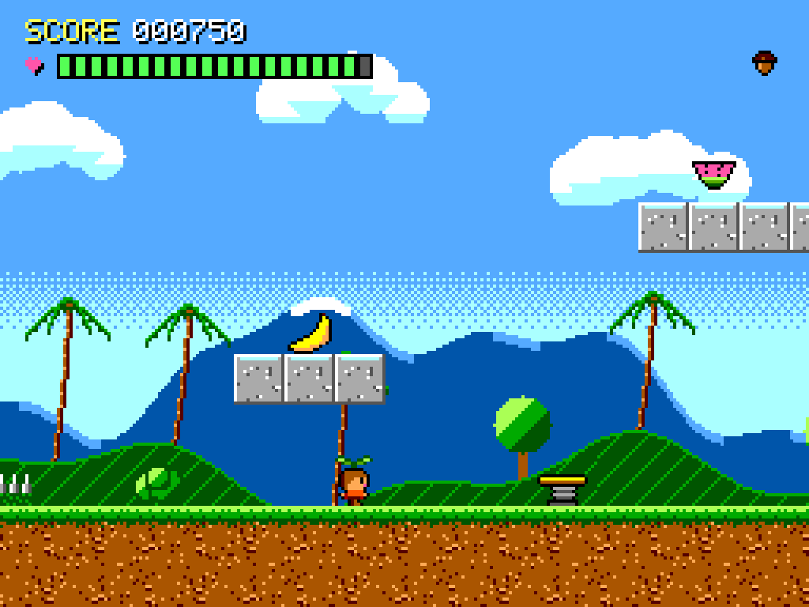
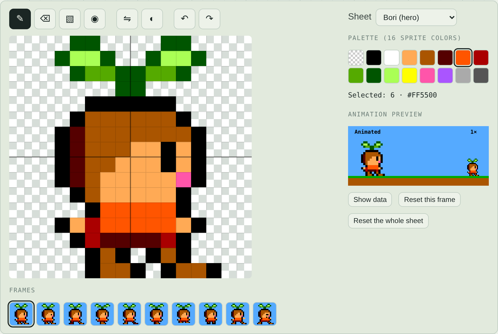
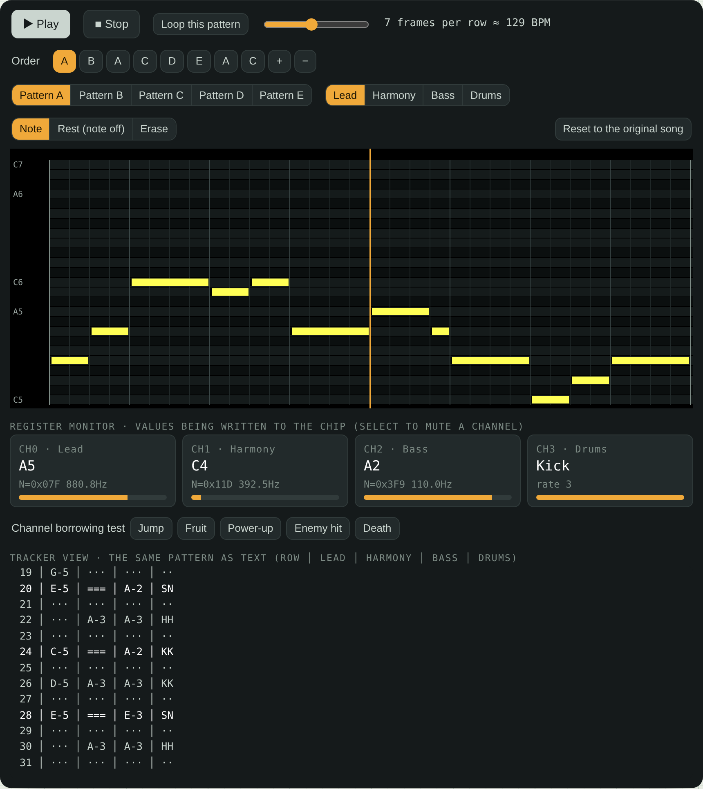
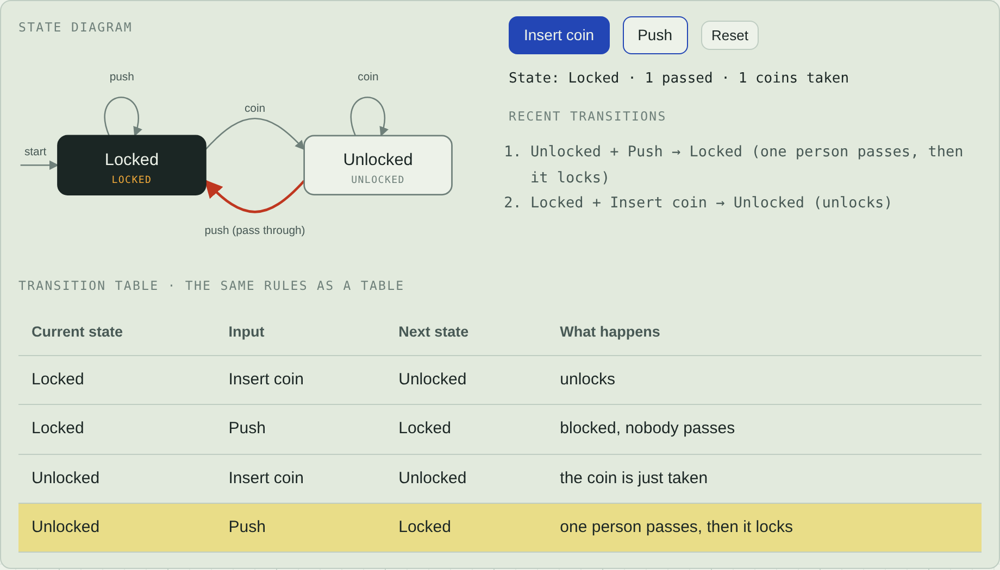
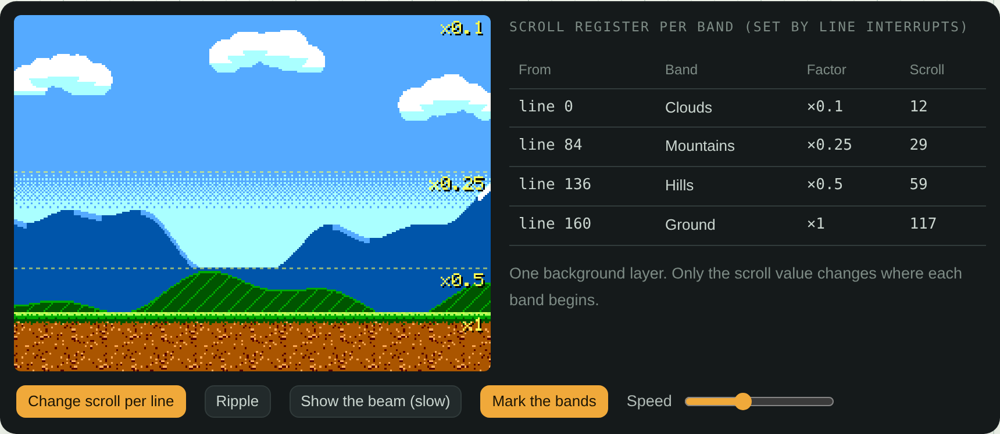

<p align="center">
  
</p>

<h1 align="center">Bori Island Dev Notes</h1>

<p align="center">
  An interactive notebook that builds a Wonder Boy-style 8-bit platformer from an empty canvas, one working part at a time.<br>
  Plain HTML, CSS and JavaScript. No libraries, no framework, one build script.
</p>

<p align="center">
  <a href="https://sanghyunpark.pages.dev/apps/bori-island/?lang=en"><b>Open the notebook</b></a>
  &nbsp;·&nbsp;
  <a href="https://sanghyunpark.pages.dev/apps/bori-island/?lang=ko">한국어로 보기</a>
  &nbsp;·&nbsp;
  <a href="README.ko.md">README (한국어)</a>
</p>

---

Every chapter explains one part of the game and lets you change it on the spot. The parts are wired together: repaint Bori's shirt in the pixel editor, raise the gravity in the physics lab, or move a pit in the level editor, and the finished game in the last chapter plays with your changes.

The game borrows its rules from Wonder Boy (1986): a vitality meter that drains over time, fruit that refills it, weapons hidden in eggs (here, flower buds), rocks that trip you, and a screen that never scrolls back. The character, art, music, level and code are all original. The numbers come from the Sega Master System: a 256 × 192 screen, 16 of 64 colors per palette, eight sprites per line, and a sound chip with three square waves and a noise channel.

## Chapters

| | Chapter | What you can try |
|---|---|---|
| 0 | Introduction | The finished game playing itself, the hardware budget, how the parts connect |
| 1 | The game loop | Variable Δt against fixed Δt side by side, an accumulator timeline, interpolation |
| 2 | Sprites and animation | Palette-indexed pixels, animation tables, palette swaps, the eight-sprites-per-line flicker |
| 3 | Tile maps, parallax, camera | A tile inspector, parallax layers spread out in 3D, a dead-zone camera |
| 4 | Authoring tools | A pixel editor, autotiling, a level editor with test-from-here, character map / RLE / JSON formats |
| 5 | Sound effects and music | A PSG keyboard with real register values, a sound-effect designer, a tracker with a register monitor |
| 6 | Game physics | A jump arc lab, tile collision one step at a time, coyote time and jump buffering, tunneling |
| 7 | Input, state machines, juice | Input edges, what a state machine is (turnstile, flags vs. states), Bori's live state machine, juice switches, debug overlays, a bitmap font |
| 8 | Hardware, then and now | A VRAM tile budget, raster scrolling, integer scaling, a score vs. a recording, mixing and ducking, slowdown and frame budgets |
| 9 | Play the game | The whole game, using every change you made in the tools |

The page is fully bilingual. Add `?lang=en` or `?lang=ko` to the address, or use the language button in the sidebar.

## Screenshots

<table>
  <tr>
    <td width="50%"><br><sub><b>Chapter 4.</b> The pixel editor saves 256 palette numbers per frame, and every game screen picks up the change.</sub></td>
    <td width="50%"><br><sub><b>Chapter 5.</b> A tracker driving an emulated PSG chip, with the register values it writes every frame.</sub></td>
  </tr>
  <tr>
    <td width="50%"><br><sub><b>Chapter 7.</b> State machines start with a turnstile before moving on to Bori's six states.</sub></td>
    <td width="50%"><br><sub><b>Chapter 8.</b> Raster scrolling: one background layer, a new scroll value at the start of each band.</sub></td>
  </tr>
</table>

## Run it locally

You only need Node.js 20 or later. The build has no dependencies.

```sh
git clone https://github.com/sean-lab/bori-island.git
cd bori-island
node scripts/build.mjs        # writes dist/index.html
```

Open `dist/index.html` in a browser. It's one self-contained file, so it also works straight from disk.

| Command | What it does |
|---|---|
| `node scripts/build.mjs` | Bundles `src/` into `dist/index.html`, opening in English |
| `node scripts/build.mjs --lang=ko` | Same, but opens in Korean when the address has no `?lang=` |
| `npm test` | Builds, then opens every chapter in both languages at desktop and phone widths in headless Chromium, failing on script errors, sideways scrolling or untranslated text. Finally it lets the self-playing demo run the whole level and checks that it reaches the goal. Run `npm install` and `npx playwright install chromium` once first. |
| `npm run screenshots` | Regenerates the images in `docs/screenshots/` |

## How it's put together

```
src/
  shell.html          page frame: sidebar, chapter slots, script slot
  style.css           all styles, light and dark themes
  chapters/           one HTML file per chapter, each with Korean and English blocks
  js/
    00-util.js        DOM helpers, storage, the tr(ko, en) language helper
    01-palette.js     the 64-color SMS palette, sprite and background palettes
    02-sprites.js     sprite frames as text grids of palette numbers, animation tables
    03-font.js        the 5×7 bitmap font
    04-tiles.js       tiles, autotiling, parallax layers
    05-level.js       the level as a character map, RLE
    06-input.js       keys → actions, pressed / held / released, touch buttons
    07-loop.js        the fixed-timestep loop with an accumulator and interpolation
    08-physics.js     axis-separated AABB tile collision, one-way platforms, jump simulation
    09-audio.js       the PSG emulation, music driver, sound effects, mixing modes
    10-world.js       the game: player state machine, enemies, items, camera, HUD, scenes
    2x-ch-*.js        the interactive demos for each chapter
scripts/
  build.mjs           bundles everything into one HTML file
  smoke.mjs           the headless smoke test
  screenshots.mjs     regenerates the README images
```

A few details worth reading in the source:

- **Fixed timestep.** Every demo runs on the same loop (`07-loop.js`): real time goes into an accumulator and is spent in 1/60 s steps, and rendering interpolates between the last two states. Speeds are in pixels per frame, as on the original hardware.
- **Data you can read.** Sprites are written as 16 × 16 grids of hex digits, and the level is a 192 × 12 character map. The tools edit exactly this data.
- **A chip in Web Audio.** Each tone channel is a square-wave oscillator whose frequency comes from a 10-bit register value, N, as on the real chip; noise comes from a 16-bit LFSR. The driver schedules register writes 0.12 s ahead on the audio clock. The same driver renders the song offline in Chapter 8.
- **Two languages, one file.** Chapters hold paired `data-l="ko"` and `data-l="en"` blocks, and scripts call `tr(ko, en)`. A small boot script picks the language from `?lang=`, a saved choice, or the build default before the first paint.

## Releases

Pushing a `v*` tag runs `.github/workflows/release.yml`, which tests the build and attaches `bori-island-<tag>.tar.gz` (with `index.html` at its root) to a GitHub release. [sanghyunpark.dev](https://sanghyunpark.pages.dev) deploys a pinned release at `/apps/bori-island/`.

## Credits

The game's rules are inspired by *Wonder Boy* (Escape / Sega, 1986). Bori, the art, the music, the sound effects, the level and all code are original to this project, which is not affiliated with or endorsed by Sega or any Wonder Boy rights holder. "Master System" is a trademark of Sega and is used here only to describe the hardware.

## License

[MIT](LICENSE) © 2026 Sanghyun Park
